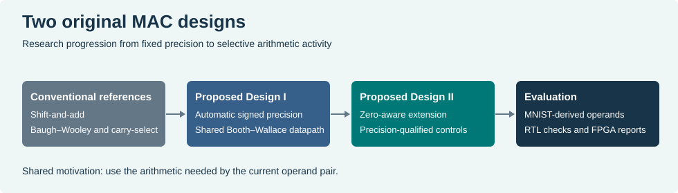
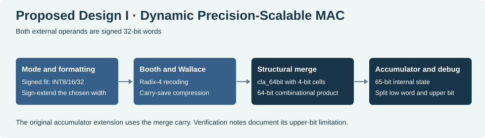
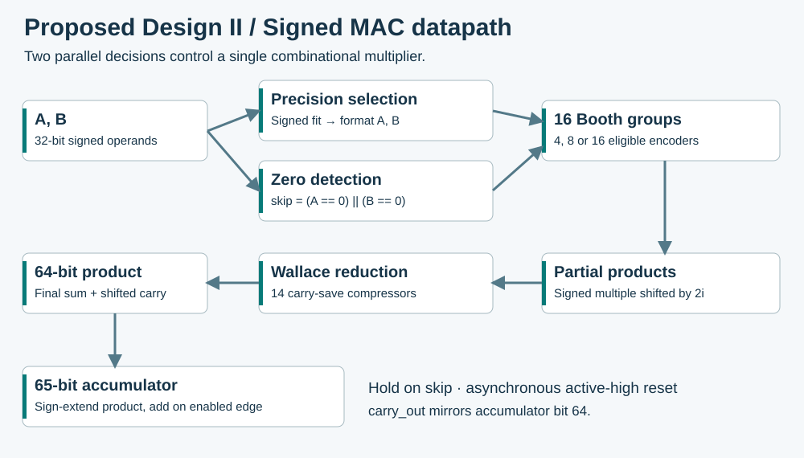
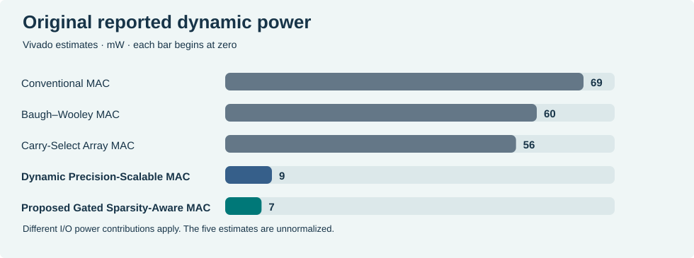
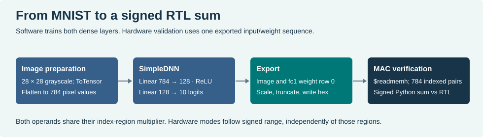
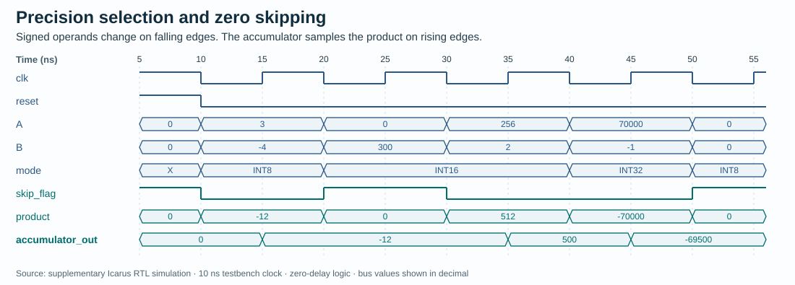

# Dynamic Precision-Scalable and Sparsity-Aware MAC Unit for Deep Neural Network Accelerators

**Precision-adaptive arithmetic · Sparsity-aware computation · Fine-grained gating for DNN acceleration**

This project develops two signed MAC architectures around one question: how much arithmetic needs to be active for each operand pair? The first shares a radix-4 Booth and Wallace-tree datapath across INT8, INT16 and INT32. The second adds zero detection, selective partial-product activity and a conditional accumulator update. A PyTorch model supplies a 784-pair validation workload with preserved input files.

**Design II implementation highlights** · 7 mW reported estimated dynamic power · 23.613 ns reported input-to-output path · 2,568 LUTs · 0 DSP blocks



## Original Research Contributions

### Proposed Design I — Dynamic Precision-Scalable MAC

`adaptive_mac_top` detects the narrowest common signed width of two 32-bit operands at runtime. A shared modified Booth recoder generates signed partial products, a Wallace network compresses them with carry-save arithmetic, and the `cla_64bit` hierarchy merges the two remaining vectors. The hierarchy’s four-bit carry cells propagate carry sequentially. The product and debug interface supported the original mode and waveform analysis.



### Proposed Design II — Dynamic Precision-Scalable Sparsity-Aware MAC with Gating Logic

`mac_sparse_ulp_precision_gated` retains signed width selection and the Booth–Wallace datapath. Zero detection runs alongside width selection. The design masks Booth encoder controls before partial-product generation using `be_enable = !skip && precision_enable`. Four, eight or sixteen radix-4 groups are eligible in INT8, INT16 or INT32. A zero operand suppresses all groups and holds the 65-bit accumulator. The mask controls datapath activity and the register uses the original clock with a conditional update.



| Feature | Proposed Design I | Proposed Design II |
|---|---|---|
| Operand interface | Two signed 32-bit inputs | Two signed 32-bit inputs |
| Mode selection | Automatic signed fit, INT8/16/32 | Same selection, combined with group eligibility |
| Final product merge | Structural CLA hierarchy | Native addition mapped onto FPGA carry chains |
| Accumulation | 65-bit internal state with split low-word and upper-bit outputs | Signed 65-bit sign-extended update modulo 2⁶⁵ |
| Zero operand | Normal datapath operation | Partial-product suppression and accumulator hold |

[Datapaths, interfaces and cycle behavior](docs/architecture.md) · [Both designs compared](assets/architecture/design-comparison.svg)

## Original performance comparison

The final report compares three conventional references and both proposed designs. The values below reproduce Tables 4.9, 4.11, 4.13 and 4.14. The clock constraint was 12 MHz on Artix-7.

| Architecture | Slice LUTs | Occupied slices | Reported path (ns) | Dynamic estimate (mW) | Total estimate (mW) |
|---|---:|---:|---:|---:|---:|
| Conventional Fixed-Precision MAC | 1,518 | 421 | 28.010 | 69 | 200 |
| Baugh–Wooley MAC with Carry-Save and Carry-Lookahead Addition | 2,027 | 632 | 49.669 | 60 | 191 |
| Non-Booth Array MAC with Carry-Save Reduction and Carry-Select Addition | 2,283 | 684 | 37.468 | 56 | 187 |
| **Proposed Design I — Dynamic Precision-Scalable MAC** | **2,409** | **693** | **33.255** | **9** | **131** |
| **Proposed Design II — Gated Sparsity-Aware MAC** | **2,568** | **711** | **23.613** | **7** | **129** |



- **Conventional comparison.** 69 versus 7 mW is a 62 mW difference, or 89.86% of the original conventional estimate. The estimates have different I/O contributions and are unnormalized.
- **Baugh–Wooley comparison.** 60 versus 7 mW gives an 88.33% numerical difference with different I/O contributions. The reported paths are 49.669 versus 23.613 ns, a 52.46% decrease across the reported path measurements.
- **Architectural extension.** Table 4.17 gives 9 versus 7 mW dynamic (22.22% lower estimated), with 159 extra LUTs (+6.60%), 18 extra slices (+2.60%) and 65 registers in both. Its 28.99% path decrease uses 33.255 and 23.613 ns, which end at a register and an output respectively. The Design II input-to-register path is 24.111 ns.

[Delay chart](assets/graphs/original-delay.svg) · [LUT chart](assets/graphs/original-luts.svg) · [Path categories, I/O contributions and report conditions](docs/performance-analysis.md)

## DNN Workload Generation and Software–Hardware Co-Verification

### Neural Network Model and MNIST Preparation

The original `SimpleDNN` trains on grayscale 28×28 MNIST images using two dense layers (784 → 128 → 10), ReLU and cross-entropy. The generator selects the first training image and the first row of the first layer’s trained weights. The RTL workload represents the **784 products of one scaled, bias-free weighted sum**. Software executes model training. RTL verifies integer MAC arithmetic on the exported pair stream.

### Hardware-Compatible Data Generation and RTL Integration

The generator flattens the image in tensor order and scales both operands at index `i` by 50, 5,000 or 100,000, depending on the index region. Python’s `int` truncates toward zero. The script masks each integer to 32 bits and writes eight hexadecimal digits per word to `activations.mem` and `weights.mem`. The testbench reads the two files with `$readmemh` and drives the same index from each file. Width selection follows the actual signed operands, independently of the software scaling region.



### Precision and Sparsity Analysis

The academic report records 307 INT8, 430 INT16 and 47 INT32 selections. In that trace 737 of 784 pairs (94.0%) fit INT8 or INT16. Its sparse-adaptive trace reports **642 of 784 skipped (81.89%)**, with 31 INT8, 64 INT16 and 47 INT32 executions. The preserved **DNN** files used by Proposed Design II’s replay produce **629 of 784 skipped (80.23%)**, with 46, 62 and 47 executions. These are counts of zero-valued operand pairs in the respective traces. In the preserved DNN files, 619 input words and 71 weights are zero, with 61 overlapping pairs.

[Precision distributions](assets/dnn/precision.svg) · [Skipped versus executed](assets/dnn/sparsity.svg) · [Dataset and trace provenance](docs/DATASET_PROVENANCE.md)

### Golden Reference and Reproduction

| Test | Reference | Observed |
|---|---:|---|
| Proposed Design II, frozen DNN workload | 3,995,709,172 (`0xEE29AEF4`) | XSim matched after 784 pairs and completed all 38 directed product checks |
| Conventional, Baugh–Wooley and carry-select references, alternate MEM_Files | −26,017,714,596 | Three reference outputs matched the signed 65-bit checkpoint |
| Proposed Design II, independent per-cycle oracle | Product, width, skip and 65-bit state each cycle | 3,043 checks passed, including nine signed wraps |

```sh
python verification/check_datasets.py
python scripts/simulate.py candidate3
python scripts/simulate.py comparison
```

[PyTorch workload reproduction](docs/DNN_WORKLOAD_REPRODUCTION_GUIDE.md) · [Hardware reproduction](docs/reproduction.md) · [Verification and known issue](docs/verification.md)

The original Design I accumulator can misstate bit 64 because it extends the product with carry-out. Its combinational product remains available for the independent array project. [Known issue](docs/verification.md)

## Demonstration



The trace shows a zero operand holding the sum at −12 before wider operands exercise INT16 and INT32. A genuine Vivado capture illustrates [Design I’s debug interface](assets/architecture/adaptive-mode.jpg). The exhibition film’s walkthrough and result graphics are available in the private review package with timestamped context.

## Repository guide

| Path | Contents |
|---|---|
| `rtl/` | Both original proposed designs, conventional references and shared modules |
| `software/pytorch/` | Original model, training, export and mathematical golden calculation |
| `datasets/`, `testbench/`, `verification/` | Paired memory words, original benches and supplementary checks |
| `constraints/`, `scripts/`, `results/`, `docs/` | Build flow, evidence, operating details and reproduction |

The independent array project uses Proposed Design I’s combinational product path with a separate 80-bit accumulator. Its parallel and systolic schedules are documented in that repository.

[Software–hardware verification](docs/SOFTWARE_HARDWARE_VERIFICATION.md)

## Academic Project & Acknowledgments

- **Lead Developer, Primary Technical Contributor & Repository Maintainer**: **Likhith B** ([LikhithB05](https://github.com/LikhithB05)) — hardware architecture design, Verilog RTL implementation (`adaptive_mac_top` and `mac_sparse_ulp_precision_gated`), dynamic precision scalability (`INT8`/`INT16`/`INT32`), sparsity-aware gating logic, hardware optimization, functional verification and simulation, PPA analysis, PyTorch and MNIST workload generation, hardware–software integration, and technical documentation.
- **Academic Team**: Developed as a group Major project in the Department of Electronics and Communication Engineering, **JSS Academy of Technical Education, Bengaluru** (affiliated with **Visvesvaraya Technological University (VTU)**, Academic Year **2026–2027**) alongside teammates **Ananya S**, **Apoorva Sheshadri**, and **K. S. Sindhura**, under the academic guidance of **Mrs. Sunita L. Shirahatti** *(Assistant Professor, Dept. of ECE)*.

Full attribution and repository licensing status are recorded in [AUTHORS.md](AUTHORS.md).
