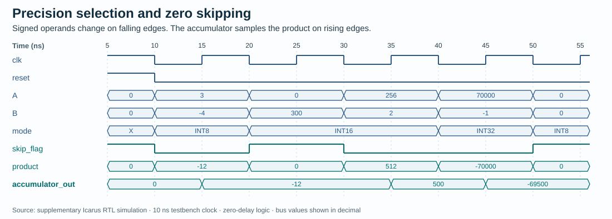

# Verification and workload identity

Original testbenches are preserved in testbench/. The independent reproducibility audit executed them with Vivado XSim 2026.1. The separate SystemVerilog oracle in verification/ was written after the project.

| Workload | Signed sum | Encoded in 65 bits | Zero pairs | Active INT8 / 16 / 32 |
|---|---:|---|---:|---|
| DNN | 3,995,709,172 | 0x000000000ee29aef4 | 629 / 784 | 46 / 62 / 47 |
| MEM_Files | −26,017,714,596 | 0x1fffffff9f1392e5c | 629 / 784 | 44 / 64 / 47 |

Each line encodes a signed 32-bit word in hexadecimal. The two activation files are byte-identical. The weights differ. Signed products accumulate without scale conversion; comparisons use actual signed operand range for each pair. A zero activation or weight defines a skip.

The original generation script trains a 784→128→10 dense network on MNIST with Adam for two epochs, then takes the first training image and the first layer's first neuron's weights. It scales coordinates 0–249 by 50, 250–499 by 5,000, and 500–783 by 100,000 and truncates. These scale factors deliberately exercise multiple precisions. They do not form a single fixed-point output scale. Training is unseeded. The retained memory pairs provide deterministic inputs. Exact training runs and checkpoint identity for the two weight files are undocumented.

Proposed Design II's original test compares 38 individual products and one final 784-pair accumulator. Its printed software-reference hexadecimal literal contains a typographical error. Its executable comparison uses the correct decimal constant. Skips are counted from stimulus in this bench. The supplementary oracle checks skip, product, carry, mode and accumulator on individual cycles; it checks 1,001 INT8, 1,002 INT16 and 1,040 INT32 operations, including 37 skip pairs and nine wrap events.

## F-01 and earlier benches

Original adaptive_mac_top forms {cla_cout, cla_sum} before accumulation. A 64-bit unsigned carry from adding two compressor vectors is independent of their signed sum's sign. A wrong extension changes the 65-bit output by 2⁶⁴ modulo 2⁶⁵. The multiplier's 64 bits and the accumulator's low 64 bits remain correct for this particular defect. The sparse wrapper instantiates the same affected core. Unified XSim produced 0x0fffffff9f1392e5c on both versus the expected 0x1fffffff9f1392e5c. Proposed Design II uses the product sign bit.

A supplementary private test changed just the extension bit and all five references matched the alternate checkpoint. The original baseline source is retained here. The signed fix has no corresponding fresh PPA report. A separate historical clean wrapper uses an enable-capable accumulator dependency and must be built in its own library.

Two other legacy benches contain wiring errors. A missing acc_enable produced 808 failed comparisons over 804 steps; an undriven two-bit mode monitor displayed zz throughout 784 steps. Connecting the missing signals in isolated diagnostic copies resolved those symptoms. These are separate from F-01.

The conventional candidate benches count several checks per vector. Candidate 2 increments the final checkpoint's total counter but omits a corresponding successful-pass increment. Its 1,791 checks therefore produce 1,790 pass-counter increments with zero failures.

[Trace, stimulus and reproduction](../results/simulation/waveform.md)
